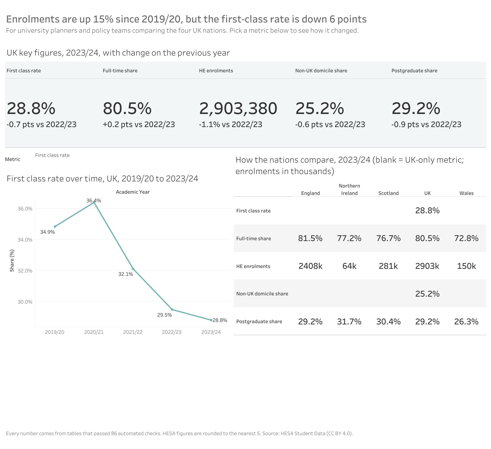

# Trusted Metrics: UK higher education

A small, end-to-end project on one idea: **a dashboard should only show numbers that have passed automated checks, and every number should carry its own definition.**

It uses open HESA Student data (England, Scotland, Wales and Northern Ireland) and covers five metrics: HE enrolments, full-time share, postgraduate share, non-UK domicile share and first-class degree rate.

**Dashboard:** [UK Higher Education: Trusted Metrics on Tableau Public](https://public.tableau.com/views/UKHigherEducationTrustedMetrics/Dashboard1)



## What is in here

| Step | What it does | Where |
|---|---|---|
| 1. Profile | Profiled the raw files and logged 11 data-quality issues with evidence | [`docs/quality_log.md`](docs/quality_log.md) |
| 2. Model | dbt models (staging, marts, metrics) on DuckDB, with generic and singular tests | [`dbt/`](dbt/) |
| 3. Define | Five governed metrics, each with definition, formula, source figure and caveat | [`dbt/seeds/metric_definitions.csv`](dbt/seeds/metric_definitions.csv) |
| 4. Prove | 86 tests pass on clean data; deliberately broken data is caught | [`docs/test_evidence.md`](docs/test_evidence.md), [`scripts/mutation_check.py`](scripts/mutation_check.py) |
| 5. Show | Export runs `dbt build` first and stops if anything fails, so the dashboard never sees untested data | [`scripts/export_for_tableau.py`](scripts/export_for_tableau.py) |
| 6. Compare | Same five questions put to an AI assistant with raw files vs governed metrics | [`docs/ai_comparison.md`](docs/ai_comparison.md) |

## Findings worth knowing

- **The same headline number appears twice with different values.** Total HE enrolments for 2023/24 is 2,903,380 in Figure 4 and 2,904,425 in Figure 3. The governed metric fixes one source (Figure 4) and says so.
- **Totals sit inside the data rows**, so a plain `SUM` overcounts. The models separate detail from totals and test that they reconcile.
- **Published counts are rounded to the nearest 5**, so parts do not always equal wholes. Tests allow for this explicitly rather than hiding it.
- **Table 61 sits about 0.2% above Figure 4.** This raises a warning by design. It is recorded, not suppressed.

Headline results (UK, 2023/24): enrolments 2,903,380; full-time share 80.5%; postgraduate share 29.2%; non-UK domicile share 25.2%; first-class rate 28.8% (down from 34.9% in 2019/20).

## Do the tests catch real problems?

I broke a copy of the database in four ways (an inflated count, a mislabelled category, a duplicated row, a count that is not a multiple of 5). dbt failed 7 tests and skipped 19 downstream models, so nothing downstream, including the dashboard, would have been refreshed. Full table in [`docs/test_evidence.md`](docs/test_evidence.md).

## Does governance change what an AI assistant says?

Modestly, and I report it as found. Two fresh Claude agents answered five questions, one from raw files and one from the governed table. They matched on four of five; the raw-files agent chose the other published enrolment total. What governance added was a single stated source and a caveat on every answer, not higher accuracy. One run each, so treat it as an observation, not a statistic. Details in [`docs/ai_comparison.md`](docs/ai_comparison.md).

## Run it yourself

```bash
pip install dbt-core==1.12.6 dbt-duckdb==1.11.0 duckdb
# 1. Download the HESA Student data CSVs (see Data below) into raw/ and raw_t61/
python scripts/load_raw.py raw raw_t61 db/hesa.duckdb   # load raw text into DuckDB
cd dbt && dbt build --profiles-dir .  # models + 86 tests
cd .. && python scripts/export_for_tableau.py   # exports only if the build passes
python scripts/mutation_check.py      # optional: break a copy and watch tests fail
```

## Limits

- Five metrics, one data release. This is a demonstration of method, not a full analytics platform.
- Nation-level values exist for three of the five metrics; first-class rate and non-UK share are UK-only.
- The AI comparison is five questions, one run each.

## Data and licence

Contains data from the Higher Education Statistics Agency (HESA), **Higher Education Student Statistics**, licensed under [Creative Commons Attribution 4.0 International (CC BY 4.0)](https://creativecommons.org/licenses/by/4.0/). Source: https://www.hesa.ac.uk/. HESA does not endorse this project, and any errors are mine. Figures are rounded by HESA to the nearest 5.

Code in this repository: MIT licence (add a `LICENSE` file before publishing).
